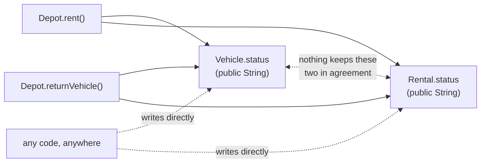
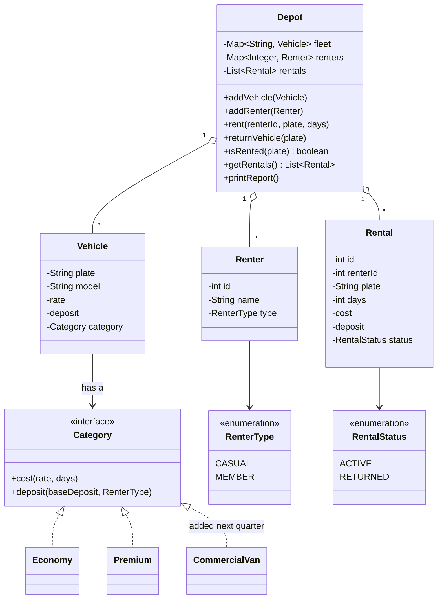
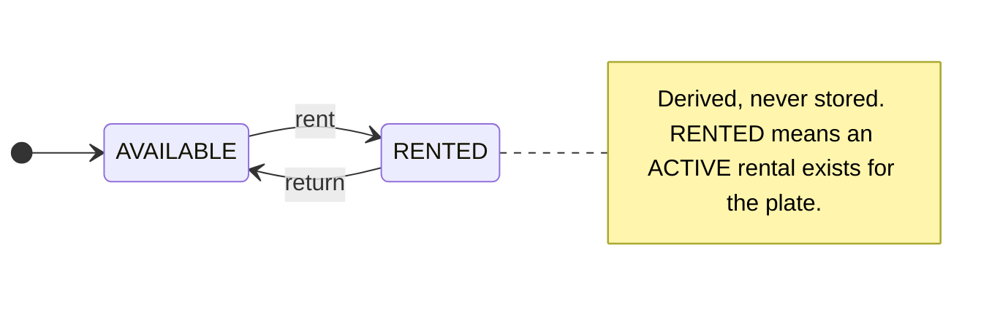

# Diagnosis: Dovewing Car Rentals Tracker

## 1. Summary

The tool does what the front desk needs on a good day, but its core data can contradict
itself. A car's "is it out?" answer is stored in two places, nothing stops outside code from
writing either one, and the rent and return methods never check what state a car is in
before changing it. Everything lives in one file, and the pricing rules are copy-pasted, so
a change to one rule can break another.

## 2. Most dangerous problem

**A vehicle can be rented to two people at once, and the system then loses track of who
has the car.** This is exactly the rule the owner says must never be broken.

For a rental depot this is the worst failure, because the tool exists to answer one question
truthfully: _is this car free?_ When it answers wrongly:

- Two customers are told the same car is theirs. One of them arrives to find it gone.
- When the first customer returns the car, the system marks it **available and closes both
  rentals**, even though the second customer still has it (see [R1](#r1-double-booking-then-one-return)). A third customer can
  then be handed a car that is physically out.
- The deposit and cost for each rental were still recorded. Nobody can tell which are valid.
- This is why staff keep a paper backup. Once staff stop trusting the screen, the tool has
  no value.

Defects #1 to #3 and #8 feed directly into this status problem. The remaining defects
(#4, #5, #6, #7 and #9) are separate correctness problems that cost the depot in other ways.

## 3. Defects, ranked by business impact

Line numbers refer to the original source, before any change. Evidence labels R1 to R5 link to the
reproductions in [section 6](#6-evidence).

### 1. Rent and return change a car's state without checking it first

**Principle broken:** fail-fast, single source of truth, and encapsulation.

|                   |                                                                                                                                                                                                                                                                                                                              |
| ----------------- | ---------------------------------------------------------------------------------------------------------------------------------------------------------------------------------------------------------------------------------------------------------------------------------------------------------------------------- |
| **What's wrong**  | `rent` (lines 113-136) never checks whether the car is already rented. `returnVehicle` (lines 138-146) sets the car `AVAILABLE` **first**, checks nothing, has no `break` so it closes **every** active rental with that plate, and prints "Returned" even if nothing was rented.                                            |
| **Root cause**    | Neither method checks the current state before changing it. Underneath that, the state is a public `String` (line 41) recorded in two places, `Vehicle.status` and `Rental.status` (lines 41, 79). So even a correct check in these two methods could be bypassed by other code.                                             |
| **Business risk** | Double bookings and disputes at the counter. After a double booking, one return frees the car and cancels both rentals while a customer still holds it (see section 2). Staff are told "Returned" for a car that was never out.                                                                                              |
| **Evidence**      | Baseline output (the Vitz appears under two active rentals); [R1](#r1-double-booking-then-one-return) (one return closes both rentals); [R4](#r4-returning-a-car-that-was-never-rented) ("Returned" for a car never rented); [R5](#r5-duplicate-plate-negative-days-and-an-outside-write) (writing the status from outside). |



### 2. Silent rentals with no price and no status change

**Principle broken:** fail-fast.

|                   |                                                                                                                                                                                                                  |
| ----------------- | ---------------------------------------------------------------------------------------------------------------------------------------------------------------------------------------------------------------- |
| **What's wrong**  | Only exact `"ECONOMY"` and `"PREMIUM"` are handled (lines 115, 124). Any other category skips both branches, but the `history.add` and `rentals.add` lines (134-135) sit **outside** the branches and still run. |
| **Root cause**    | Category is free text, and the shared bookkeeping is not part of the branch logic.                                                                                                                               |
| **Business risk** | A GHS 0 rental is recorded, nothing is printed, and the car stays `AVAILABLE` while an active rental exists. Free rentals with no warning. This is also what happens to a commercial van next quarter.           |
| **Evidence**      | [R2](#r2-lowercase-category).                                                                                                                                                                                    |

### 3. The same car can be registered twice

**Principle broken:** single source of truth (one record per physical car).

|                   |                                                                                                                                |
| ----------------- | ------------------------------------------------------------------------------------------------------------------------------ |
| **What's wrong**  | `addVehicle` (lines 104-106) accepts any vehicle, including a second one with the same plate.                                  |
| **Root cause**    | The fleet is a bare list with no uniqueness rule. A constructor cannot enforce this, because it cannot see the other vehicles. |
| **Business risk** | Two objects, each with its own status, for one physical car. This is another route to defect 1.                                |
| **Evidence**      | [R5](#r5-duplicate-plate-negative-days-and-an-outside-write) (the report lists two vehicles with the same plate).              |

### 4. Free-text categories and renter kinds

**Principle broken:** type safety.

|                   |                                                                                                                                                                 |
| ----------------- | --------------------------------------------------------------------------------------------------------------------------------------------------------------- |
| **What's wrong**  | `category` and `kind` are public strings compared with `.equals` (lines 40, 59, 115, 118, 124, 127). `"Member"` is not `"MEMBER"`.                              |
| **Root cause**    | The compiler cannot check a string. A typo is valid code that behaves differently.                                                                              |
| **Business risk** | A member mistyped as `"Member"` is charged a deposit they should not pay (GHS 2000 on a Prado). A wrong deposit damages customer trust and creates refund work. |
| **Evidence**      | [R3](#r3-renter-kind-typed-as-member).                                                                                                                          |

### 5. Pricing rules are copy-pasted

**Principle broken:** DRY.

|                   |                                                                                                                                                                                                                                                            |
| ----------------- | ---------------------------------------------------------------------------------------------------------------------------------------------------------------------------------------------------------------------------------------------------------- |
| **What's wrong**  | The economy and premium branches (lines 115-133) are identical line for line.                                                                                                                                                                              |
| **Root cause**    | The rule lives in the method that rents, not with the vehicle category it belongs to.                                                                                                                                                                      |
| **Business risk** | This is how a change to premium pricing once broke economy. Editing one copy and not the other, or touching the shared lines beneath them (134-135), changes behaviour for both. Adding a van means a third copy and a new place to make the same mistake. |

### 6. Weak links between records, and no registration check

**Principle broken:** referential integrity.

`Rental` stores the renter's **name** and the vehicle's **plate** as strings (lines 74-75).
Two renters with the same name are indistinguishable. `rent` also never confirms the vehicle
and renter are actually registered at this depot (line 113).
**Risk:** returns and history attach to the wrong person or car.

### 7. No input validation

**Principle broken:** fail-fast.

`days` can be zero or negative. **Risk:** nonsense costs enter the books ([R5](#r5-duplicate-plate-negative-days-and-an-outside-write): GHS -300.0 for
-2 days).

### 8. Internals are exposed

**Principle broken:** encapsulation.

`vehicles` and `renters` are public lists (lines 96-97). `getRentals()` returns the real
internal list (line 148). Every field of every class is public. **Risk:** this is how defect 1
becomes possible. It also means no class can promise anything about its own data.

### 9. Money stored as `double`

**Principle broken:** exact representation of domain values.

Costs and deposits are `double` (lines 38-39, 77-78). Most decimal values cannot be stored
exactly in binary, so rounding errors can accumulate in totals. **Risk:** small today at this
scale, but wrong in principle for currency.

**Fix:** amounts become `BigDecimal` with two decimal places (pesewas), built from strings. To keep
output identical to the baseline, one formatting helper strips trailing zeros but keeps at least
one decimal digit, so `450.00` prints as `450.0`, `0.00` as `0.0` and `450.50` as `450.5`,
exactly as the `double` did.

### Lower-priority issues

Listed for completeness, not ranked, because they cost the developer rather than the depot:

- Printing is mixed into business logic (lines 122, 131, 145), so nothing can be tested
  without reading the console. **Principle broken:** separation of concerns.
- Static id counters (lines 43, 62, 80) are global state, and the vehicle and renter `id`
  fields are never used.
- Everything is in one file, and names like `d`, `r`, `v`, `rt`, `reg` hide meaning. **Principle broken:** separation of concerns.
- Renter `history` is written but never read, so it has no effect on any output.

## 4. Behaviour I will preserve

The rebuild must match the baseline output (captured from the original code before any change and
committed in this repo) **exactly**, except for the intended differences listed below.

- Message formats, including `cost GHS 450.0` and `deposit GHS 0.0`.
- Pricing: `cost = dailyRate x days`. Deposit is the vehicle's deposit, and members pay `0`.
- Report layout and order: fleet in the order added, then active rentals.
- Rental numbering: the counter counts every rental created, including returned ones (the
  Prado's rental was `#2`).

**The intended differences:**

1. **Line 29 of `main`** (renting the already-rented Vitz to Ama) is refused. `Depot` throws and
   `main` catches it and prints the message, so the fourth output line changes and `Rental #3`
   no longer appears in the report.
2. **Rental numbers after a refused attempt.** A refused attempt does not consume a rental id. In
   the baseline the refused rental was the last one created (`#3`), so no other printed number
   changes. On a longer day, every rental after a refused one would be numbered lower than in the
   original, by the number of refused attempts before it.
3. **Plate handling.** Plates are normalised (trimmed, upper-cased) **only for the lookup key**.
   The plate that is _printed_ stays exactly as entered, so no baseline line changes. The
   difference is that two plates differing only in case or spacing now count as the same car, and
   the second is refused.
4. **Ledger block.** The only new output is the `Ledger:` block printed at the end of `main`
   (events, active rentals, status), from the one improvement beyond the brief. Every other output
   line is identical to the baseline apart from differences 1 to 3.

Other quirks I find (for example validation of `days`) will be recorded and flagged in the
design notes as deliberate deviations. I will not change them silently.

## 5. Planned structure (design sketch)

One class per concept. **`Depot` is the only class that can change rental state**, because it
is the only one that sees vehicles, renters and rentals together.



`getRentals()` already existed in the original and returned the real internal list. It stays, so
no feature is lost, but it now returns `List.copyOf(...)`, a snapshot, so callers cannot add or
remove rentals through it. `List.copyOf` is a shallow copy, so `Rental` also exposes no public
mutators. `isRented(plate)` is the one genuinely new query method: it replaces reading the old
`status` field, because status is now derived.

**Status is derived, not stored.** A vehicle is rented if and only if an `ACTIVE` rental
exists for its plate. With one record instead of two, the two cannot disagree.



Renting a car that is already rented, or returning one that is not rented, throws an exception
and changes nothing.

`printReport()` also stays on `Depot` so the end-of-day report is unchanged; it only reads state and changes nothing.

Key decisions behind the sketch (reasoning to be expanded in the `README.md` design notes):

| Decision                      | Choice                                                              | Why                                                                                                                      |
| ----------------------------- | ------------------------------------------------------------------- | ------------------------------------------------------------------------------------------------------------------------ |
| Who changes state             | `Depot` only                                                        | It is the only class that sees all three records.                                                                        |
| Vehicle status                | Derived from rentals                                                | Removes the second record that could disagree.                                                                           |
| Vehicle key                   | Plate, trimmed and upper-cased (the printed plate stays as entered) | A plate is unique for a physical car, and a generated id would not stop duplicates.                                      |
| Renter and rental links       | By id, not by name or plate string                                  | Names are not unique.                                                                                                    |
| Categories and renter kinds   | `Category` interface, plus enums for renter type and rental status  | The compiler rejects invalid values. A new category cannot compile without its rules.                                    |
| Where the member waiver lives | Inside each `Category` (it receives the renter type)                | A van can define its own deposit rule in one place.                                                                      |
| Fleet and renters             | Insertion-ordered maps, with an explicit duplicate check            | Keeps report order identical to the baseline.                                                                            |
| Vans                          | Their own `Category` (a sibling of Economy and Premium)             | The brief gives vans their own deposit rules. If a van can also be economy or premium, a body-type field is added later. |
| Rates                         | Stay on each vehicle, as in the original                            | Moving them to the category would remove a capability the original had.                                                  |

## 6. Evidence

Each block is the exact output of the original, unmodified code for that scenario, run on its own.

### R1 Double booking then one return

The Vitz is rented to Kofi, then rented again to Ama, then returned once. The end-of-day report is
printed before and after the return:

```text
Rented Toyota Vitz (GT-1234-20) to Kofi Mensah for 3 days, cost GHS 450.0, deposit GHS 500.0
Rented Toyota Vitz (GT-1234-20) to Ama Owusu for 2 days, cost GHS 300.0, deposit GHS 0.0

=== Dovewing Car Rentals - end of day ===
Fleet status:
  Toyota Vitz (GT-1234-20, ECONOMY): RENTED
Active rentals:
  Rental #1: GT-1234-20 -> Kofi Mensah (3 days)
  Rental #2: GT-1234-20 -> Ama Owusu (2 days)
Returned Toyota Vitz (GT-1234-20)

=== Dovewing Car Rentals - end of day ===
Fleet status:
  Toyota Vitz (GT-1234-20, ECONOMY): AVAILABLE
Active rentals:
```

Before the return, the Vitz is out under two rentals. After one return it shows `AVAILABLE` with no
active rentals, even though Ama still has the car.

### R2 Lowercase category

A vehicle is created with category `"economy"` (lowercase) and rented to Kofi for 3 days. No "Rented"
line is printed. The last line reads the rental's cost and deposit directly, because the report does
not print them:

```text

=== Dovewing Car Rentals - end of day ===
Fleet status:
  Toyota Vitz (GT-1234-20, economy): AVAILABLE
Active rentals:
  Rental #1: GT-1234-20 -> Kofi Mensah (3 days)
rental cost=0.0 deposit=0.0
```

The car shows `AVAILABLE` while an active rental exists, and that rental was recorded at zero cost.

### R3 Renter kind typed as Member

Setup: `new Renter("Ama Owusu", "Member")` rents the Prado for 2 days.

```text
Rented Toyota Prado (GR-5678-22) to Ama Owusu for 2 days, cost GHS 1200.0, deposit GHS 2000.0
```

Ama is a member, but her kind was typed `"Member"` instead of `"MEMBER"`. The code only recognises the
exact word `"MEMBER"` (line 118), so she was treated as a casual renter and charged the full GHS 2000
deposit. It should have been `0.0`.

### R4 Returning a car that was never rented

A car that nobody has rented is returned:

```text
Returned Toyota Prado (GR-5678-22)
```

The system reports "Returned" for a car that was never out.

### R5 Duplicate plate negative days and an outside write

Two vehicles are registered with the same plate. One is rented to Kofi for -2 days, and the report is
printed. Then that vehicle's status is set to `"AVAILABLE"` directly, from outside the depot, and the
report is printed again:

```text
Rented Toyota Vitz (GT-1234-20) to Kofi Mensah for -2 days, cost GHS -300.0, deposit GHS 500.0

=== Dovewing Car Rentals - end of day ===
Fleet status:
  Toyota Vitz (GT-1234-20, ECONOMY): RENTED
  Toyota Vitz (GT-1234-20, ECONOMY): AVAILABLE
Active rentals:
  Rental #1: GT-1234-20 -> Kofi Mensah (-2 days)

=== Dovewing Car Rentals - end of day ===
Fleet status:
  Toyota Vitz (GT-1234-20, ECONOMY): AVAILABLE
  Toyota Vitz (GT-1234-20, ECONOMY): AVAILABLE
Active rentals:
  Rental #1: GT-1234-20 -> Kofi Mensah (-2 days)
```

Both vehicles share a plate. The rental has a negative cost (GHS -300.0) and still charges a deposit.
After the outside write, both cars show `AVAILABLE` while the active rental remains.
